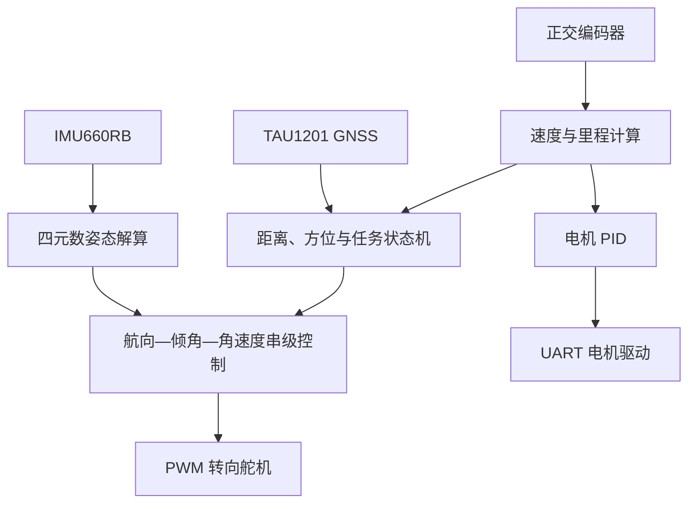

# TC264D 单车定向智能车控制系统

> 基于英飞凌 AURIX TC264D 与逐飞科技开源库实现的两轮单车自平衡、速度控制和定向行驶程序。

本项目面向全国大学生智能汽车竞赛单车定向场景。系统以转向舵机作为平衡执行机构，通过 IMU 获取车身姿态和角速度，利用串级控制器实时调整前轮转角，在维持车身直立的同时完成航向控制；编码器与电机驱动器构成速度闭环，GNSS、里程估计和任务状态机用于实现分阶段路线控制。

当前工程已经实现姿态解算、单车平衡、航向跟踪、速度闭环、GNSS 数据解析、距离估计、多任务切换、屏幕显示、蜂鸣器提示和逐飞助手波形输出。工程参数与任务路线针对当前车模和场地设定，移植到其他车辆前必须重新完成舵机、IMU、编码器、PID 和场地坐标标定。

## 主要功能

* 基于 IMU660RB 六轴惯性传感器的姿态采集
* 基于四元数积分和加速度重力反馈的姿态融合
* 车身角速度环、倾角环和航向环串级控制
* 50 Hz PWM 转向舵机控制
* 编码器反馈的电机 PID 速度闭环
* TAU1201 双频 GNSS 数据接收与解析
* 基于编码器积分的行驶距离估计
* 基于距离、航向与任务状态的路线切换
* IPS200 屏幕实时数据显示
* 按键切换任务和启停电机
* 蜂鸣器任务节点提示
* 逐飞助手虚拟示波器数据输出
* 预留 Wi-Fi、摄像头、ToF 等扩展接口

## 硬件平台

| 模块    | 当前工程配置                                    | 主要作用            |
| ----- | ----------------------------------------- | --------------- |
| 主控    | Infineon AURIX TC264D / TC26xD B-Step     | 姿态解算、实时控制和任务调度  |
| 开源库   | Seekfree TC264 Open Source Library V3.4.1 | 芯片驱动与外设支持       |
| IMU   | IMU660RB                                  | 加速度和角速度测量       |
| 转向执行器 | PWM 舵机                                    | 调整前轮转角，实现平衡和转向  |
| 电机驱动  | UART 串口电机驱动器                              | 接收占空比指令并驱动车轮    |
| 编码器   | 1024 线正交编码器                               | 速度反馈与里程估计       |
| 定位模块  | TAU1201 双频 GNSS                           | 获取经纬度、航向和定位状态   |
| 显示模块  | IPS200，SPI 接口                             | 显示姿态、速度、距离和任务状态 |
| 调试接口  | Debug UART + 逐飞助手                         | 输出调试信息和实时波形     |
| 人机交互  | 两个按键和蜂鸣器                                  | 电机启停、任务切换与节点提示  |

## 系统架构



系统的实时任务主要运行在 CPU0。CPU1 当前只完成基础初始化和双核同步，尚未分配具体计算任务。

## 软件控制流程

系统上电后，CPU0 依次完成以下初始化：

1. 系统时钟和调试串口初始化
2. 电机按键、模式按键和蜂鸣器 GPIO 初始化
3. 任务状态与控制参数初始化
4. 舵机 PWM 和舵机串级 PID 初始化
5. 电机驱动串口和电机 PID 初始化
6. 正交编码器初始化
7. TAU1201 GNSS 初始化
8. IMU660RB 初始化
9. 周期中断初始化
10. IPS200 屏幕和逐飞助手初始化
11. 等待双核同步后进入主循环

主循环负责按键检测、GNSS 数据解析、屏幕刷新和逐飞助手波形发送；姿态更新、平衡控制、速度控制和编码器采样在周期中断中执行。

## 实时任务周期

| 周期      | 中断通道        | 执行内容                     |
| ------- | ----------- | ------------------------ |
| 1 ms    | `CCU60_CH0` | 读取 IMU 加速度和角速度，更新四元数与欧拉角 |
| 2 ms    | `CCU60_CH1` | 执行平衡控制、速度闭环和任务状态机        |
| 10 ms   | `CCU61_CH0` | 读取并清零编码器增量               |
| 约 20 ms | CPU0 主循环    | 屏幕刷新、GNSS 解析和示波器数据发送     |

中断优先级和服务核心配置位于 `user/isr_config.h`。

## 控制算法

### 姿态解算

姿态解算位于 `code/Attitude.c`，处理流程为：

```text
IMU 原始数据
    ↓
单位换算
    ↓
利用加速度方向修正陀螺仪
    ↓
四元数积分
    ↓
四元数归一化
    ↓
转换为 roll、pitch、yaw
```

程序利用加速度计测得的重力方向与四元数估计的重力方向之间的误差，对陀螺仪角速度进行比例—积分修正，其形式接近基于重力反馈的 Mahony 姿态融合算法。

当前姿态更新时间为 1 ms：

```c
float dt_1 = 0.001f;
```

姿态反馈参数位于 `code/Attitude.h`：

```c
#define KP 20.0f
#define KI 0.001f
```

当前系统使用六轴 IMU，偏航角主要依赖陀螺仪积分，长时间运行时可能产生零偏漂移。GNSS 航向尚未直接融合进四元数姿态解算，因此调试时应重点观察偏航角的长期稳定性。

### 单车平衡串级控制

任务 1 和任务 3 使用三级串级控制结构：

```text
目标航向
    ↓
航向环
    ↓
目标车身倾角
    ↓
倾角环
    ↓
目标倾倒角速度
    ↓
角速度环
    ↓
舵机转角
```

车身向一侧倾倒时，控制器驱动前轮向相应方向转动，通过车辆运动产生横向加速度和扶正力矩，使车身重新接近平衡位置。

三个控制环分别由以下函数实现：

| 控制环  | 函数                        | 输入           | 输出    |
| ---- | ------------------------- | ------------ | ----- |
| 航向环  | `turn_circle_control()`   | 当前偏航角 `yaw`  | 目标倾角  |
| 倾角环  | `angle_circle_conetrol()` | 当前横滚角 `roll` | 目标角速度 |
| 角速度环 | `gyro_circle_conetrol()`  | 当前 `gyro_y`  | 舵机控制量 |

航向误差会被归一化到 `[-180°, 180°]`，避免车辆经过正负 180°边界时产生突变。

任务 2 使用较简化的航向—倾角控制结构，倾角环输出直接作用于舵机，主要用于对应当前场地的低速分段路线。

### 舵机控制

舵机驱动位于 `code/servo.c`，使用：

```c
#define PWM_CH1 ATOM1_CH1_P33_9
```

PWM 频率为 50 Hz。舵机中位和最大控制角由以下参数决定：

```c
#define servo_zero_point 395
float Max_angle = 50;
```

`Servo_control()` 会将输入角度限制在 `±50°` 范围内，再映射为 PWM 占空比。不同舵机、舵盘安装角度和机械连杆均会改变实际中位，首次上车前必须重新标定 `servo_zero_point`。

### 角速度滤波

角速度环输入使用一阶低通滤波：

```c
new_gyro = servo_gyro_filter(
    imu_data.gyro_y,
    &new_gyro,
    0.08
);
```

滤波后的角速度用于降低 IMU 高频噪声对舵机的影响。滤波系数越大，响应越快但噪声越明显；系数越小，输出越平滑但控制延迟会增加。

### 电机速度闭环

电机控制位于 `code/motor.c`。编码器每 10 ms 采样一次，任务控制器每 2 ms 根据最近一次编码器增量计算 PID 输出。

默认电机 PID 参数为：

```c
PID_Init(&motor_pid, 5, 0.15, 2, 0);
```

PID 输出被限制在：

```text
-7000 ～ 7000
```

随后通过 UART2 发送给电机驱动器。通信采用固定 7 字节数据帧，帧头为 `0xA5`，最后一个字节为累加校验值。

需要注意，任务中的 `motor_pid.set_speed` 当前表示每个 10 ms 编码器采样窗口内的目标增量，并不是直接以 m/s 为单位。用于屏幕显示的物理速度由下式换算：

```text
转速 = -编码器增量 ÷ (1024 × 4) ÷ 0.01
车速 = 转速 × 车轮周长
```

当前车轮周长设置为：

```c
float WHEEL_CIRCUMFERENCE_M = 0.24f;
```

代码采用负值表示当前车辆的前进方向。例如任务 1 和任务 3 的目标编码器增量为 `-400`。如果更换编码器安装方向、电机方向或调换编码器相线，应统一检查速度反馈符号。

### 距离估计

`distance_calculate()` 根据编码器速度进行梯形积分：

```text
本周期距离 =
（上一周期速度 + 当前速度）÷ 2 × 时间间隔 × 车轮周长
```

累计距离保存在 `init_distance` 中，单位为米。该距离用于直线长度检测、转弯完成判断和分段路线切换。

编码器里程会受到车轮打滑、轮胎变形和轮径误差影响，正式测试前应使用实际场地距离重新标定 `WHEEL_CIRCUMFERENCE_M`。

### GNSS 定向

GNSS 模块通过 UART3 工作，默认参数为：

* 波特率：115200
* 数据更新率：10 Hz
* 解析信息：RMC、GGA 等 NMEA 数据
* 输出信息：经纬度、地速、航向、卫星数量和定位状态

`code/gnss.c` 提供以下功能：

* 两点距离计算
* 两点方位角计算
* 当前航向与目标航向误差计算
* 目标点接近判断
* 绕点方向控制接口
* 场地目标点相对角度计算
* GNSS 经纬度低通滤波接口

当前任务 3 保留了 GNSS 目标点判断和方向计算接口，但部分权重仍被设置为零，主要路线仍由编码器距离和 IMU 偏航角状态机控制。GNSS 尚未形成完整的闭环路径跟踪算法。

## 当前任务逻辑

模式按键在 `Task 0` 至 `Task 4` 之间循环切换。上电默认任务为：

```c
param.task = 3;
```

因此上电后第一次按下模式键会切换到任务 4，而不是任务 1。

| 任务     | 当前代码状态  | 主要行为                    |
| ------ | ------- | ----------------------- |
| Task 0 | 调试/空闲入口 | 未定义独立路线控制               |
| Task 1 | 已实现     | 直线行驶、距离判断、掉头和反向航向保持     |
| Task 2 | 已实现     | 按累计距离切换多个目标航向，节点通过蜂鸣器提示 |
| Task 3 | 已实现     | 直线、掉头、GNSS 目标点判断及多段航向路线 |
| Task 4 | 预留      | 当前没有对应任务控制代码            |

### Task 1

任务 1 的主要过程为：

1. 目标编码器增量设置为 `-400`
2. 保持初始目标航向直线行驶
3. 累计距离超过 `first_line_distence`
4. 使用固定转向控制量进入掉头
5. 偏航角接近 180°且转弯距离达到要求后结束掉头
6. 将目标航向设置为 180°并继续行驶

默认参数为：

```c
float first_line_distence = 15.0f;
float first_turn_circle   = 6.5f;
```

如果设置了有效的起点经纬度，程序还可以同时使用 GNSS 直线距离辅助判断。目前起点经纬度默认值为 `-1`，因此该辅助判断处于关闭状态。

### Task 2

任务 2 根据累计距离切换目标航向，当前路线节点约为：

| 累计距离    | 控制动作                 |
| ------- | -------------------- |
| 起点      | 目标航向设为 53°           |
| 0.2 m   | 蜂鸣提示，继续保持 53°        |
| 1.9 m   | 目标航向切换为 -80°         |
| 4.15 m  | 进入固定转向阶段             |
| 7.75 m  | 退出固定转向，目标航向切换为 -110° |
| 10.45 m | 目标航向切换为 110°         |

任务 2 的目标速度会根据车身倾角动态降低：

```text
目标速度 = -150 - 1.5 × |roll|
```

这些距离和角度都是当前场地经验参数，不具有普遍适用性。

### Task 3

任务 3默认目标速度为 `-400`，并根据编码器速度对角速度环增益进行小幅调整。其主要过程包括：

1. 保存初始航向
2. 直线行驶并判断指定 GNSS 目标点
3. 达到直线距离后进入掉头
4. 偏航角接近 180°后进入后续分段路线
5. 依次按照 180°、150°、-160°、160°、180°等航向完成路线

场地目标点坐标目前直接写在 `code/task.c` 中。更换测试地点后必须替换，建议后续将坐标和路线参数集中放入独立配置文件。

## 引脚配置

### 用户控制与执行器

| 功能      | TC264D 引脚 | 配置                  |
| ------- | --------- | ------------------- |
| 电机启停按键  | P11.3     | 上拉输入，低电平有效          |
| 模式切换按键  | P11.2     | 上拉输入，低电平有效          |
| 蜂鸣器     | P33.10    | 推挽输出                |
| 舵机 PWM  | P33.9     | GTM ATOM1 CH1，50 Hz |
| 编码器 A 相 | P33.7     | GPT12 TIM2 CH1      |
| 编码器 B 相 | P33.6     | GPT12 TIM2 CH2      |

### 电机驱动串口

| 信号       | TC264D 引脚 | 连接方向             |
| -------- | --------- | ---------------- |
| UART2 TX | P10.5     | TC264D → 电机驱动 RX |
| UART2 RX | P10.6     | TC264D ← 电机驱动 TX |
| 波特率      | —         | 460800           |

### GNSS 串口

| 信号       | TC264D 引脚 | 连接方向             |
| -------- | --------- | ---------------- |
| UART3 TX | P15.6     | TC264D → GNSS RX |
| UART3 RX | P15.7     | TC264D ← GNSS TX |
| 波特率      | —         | 115200           |

### IMU660RB

| 信号        | TC264D 引脚 |
| --------- | --------- |
| SPI0 SCLK | P20.11    |
| SPI0 MOSI | P20.14    |
| SPI0 MISO | P20.12    |
| CS        | P20.13    |

### IPS200 屏幕

| 信号           | TC264D 引脚 |
| ------------ | --------- |
| SPI2 SCLK    | P15.3     |
| SPI2 MOSI    | P15.5     |
| SPI2 MISO/占位 | P15.4     |
| CS           | P15.2     |
| RST          | P15.1     |
| DC           | P15.0     |
| BL           | P15.4     |

### 调试串口

| 信号             | TC264D 引脚 |
| -------------- | --------- |
| Debug UART0 TX | P14.0     |
| Debug UART0 RX | P14.1     |
| 波特率            | 115200    |

部分引脚可能同时具有启动配置或特殊复用功能。修改引脚前应结合原理图、TC264D 数据手册和工程中的《尽量不要使用的引脚.txt》进行检查。

## 目录结构

```text
Seekfree_TC264_Opensource_Library/
├── code/                       # 单车控制与任务层代码
│   ├── Attitude.c/.h           # IMU 数据处理、四元数姿态解算
│   ├── servo.c/.h              # 舵机驱动和串级控制器
│   ├── motor.c/.h              # 电机串口协议、编码器速度 PID
│   ├── gnss.c/.h               # GNSS 定向与目标点计算
│   ├── task.c/.h               # 任务状态机、路线与距离控制
│   ├── key.c/.h                # 按键消抖接口
│   └── wifi.c/.h               # Wi-Fi 功能预留
├── user/
│   ├── cpu0_main.c/.h          # CPU0 主程序和外设初始化
│   ├── cpu1_main.c             # CPU1 主程序，目前为空闲框架
│   ├── isr.c/.h                # 周期、串口、DMA和外部中断
│   └── isr_config.h            # 中断优先级与服务核心配置
├── libraries/
│   ├── infineon_libraries/     # Infineon iLLD 底层库
│   ├── zf_common/              # 逐飞公共组件
│   ├── zf_driver/              # GPIO、UART、PWM、PIT等驱动
│   ├── zf_device/              # IMU、GNSS、屏幕等设备驱动
│   ├── zf_components/          # 逐飞助手等应用组件
│   └── doc/                    # 版本和许可证说明
├── .project                    # AURIX Development Studio 工程描述
├── .cproject                   # 编译器、包含路径和构建配置
├── Lcf_Tasking_Tricore_Tc.lsl  # TASKING 链接脚本
├── *.launch                    # 调试下载配置
└── README.md
```

## 开发环境

推荐使用以下环境：

* Windows 10/11
* Infineon AURIX Development Studio
* 工程注释对应 ADS v1.10.2
* TASKING TriCore 编译工具链
* Infineon DAS 调试驱动
* iSYSTEM winIDEA 调试组件或 ADS 集成调试器
* TC264D 下载器或开发板板载调试接口

工程已经包含 `Debug` 和 `Release` 两套 TASKING 构建配置。

仓库中的 `External GCC - Debug` 配置尚未完成外部 GCC 工具链设置，其生成的 Makefile 会直接提示：

```text
The active configuration requires additional settings.
Configuring an external GCC Toolchain.
```

因此首次编译应选择 `Debug`，不要选择 `External GCC - Debug`。

## 编译与下载

### 导入工程

1. 打开 AURIX Development Studio。
2. 选择 `File → Import`。
3. 选择 `General → Existing Projects into Workspace`。
4. 选择本项目根目录。
5. 确认识别到 `Seekfree_TC264_Opensource_Library`。
6. 完成工程导入。

### 选择构建配置

在工程上单击右键，选择：

```text
Build Configurations → Set Active → Debug
```

然后执行：

```text
Project → Build Project
```

正常情况下生成文件位于：

```text
Debug/Seekfree_TC264_Opensource_Library.elf
```

### 下载和调试

工程已提供：

```text
Seekfree_TC264_Opensource_Library Debug.launch
```

该配置使用：

* 目标芯片：TC264D
* 通信方式：USB
* 调试硬件：IFX_DAS
* 调试入口：`core0_main`
* 下载文件：`Debug/Seekfree_TC264_Opensource_Library.elf`

连接开发板后，可以在 ADS 中选择该调试配置启动下载。若调试器无法连接，应依次检查板卡供电、USB 驱动、DAS 服务、目标芯片型号和启动引脚状态。

## 使用方法

### 上电前检查

* 将车轮架空，避免程序异常导致车辆突然启动。
* 确认舵机中位基本正确。
* 确认电机和舵机电源满足电流要求。
* 主控、舵机、电机驱动和传感器必须共地。
* 确认编码器 A/B 相连接正确。
* 确认 IMU 安装方向与程序坐标轴一致。
* 确认 GNSS 天线连接牢固。
* 首次调试时降低电机输出限制。

### 按键操作

电机按键和模式按键均为低电平有效。

* 短按并释放电机按键：切换电机运行/停止状态
* 短按并释放模式按键：任务编号加一
* 任务编号超过 4 后回到 0

建议只在电机停止时切换任务。当前任务切换不会统一清除所有 PID 积分、距离、转弯标志和任务阶段变量，中途切换可能继承上一任务的内部状态。

### 屏幕显示

IPS200 当前显示以下信息：

* 车身横滚角 `ROLL`
* 偏航角 `YAW`
* 系统运行时间
* 编码器累计距离
* 估算车速
* 编码器原始增量
* 当前任务编号
* 倾角环、航向环等控制输出
* GNSS 目标点相对角度

### 逐飞助手

程序通过 Debug UART 与逐飞助手通信，配置了 4 个示波器通道。当前实际使用：

| 通道 | 数据                |
| -- | ----------------- |
| 0  | 原始 `gyro_y`       |
| 1  | 低通滤波后的 `new_gyro` |
| 2  | 预留                |
| 3  | 预留                |

调试平衡控制时，建议继续加入以下变量：

* `eulerangle.roll`
* `set_angle_out`
* `set_gyro_out`
* `set_turn_out`
* `encoder_data`
* `motor_pid.set_speed`
* `set_newspeed`

## 关键参数

| 参数                      |    默认值 | 文件                 | 含义          |
| ----------------------- | -----: | ------------------ | ----------- |
| `servo_zero_point`      |    395 | `code/servo.c`     | 舵机机械中位      |
| `Max_angle`             |    50° | `code/servo.c`     | 最大舵机控制角     |
| `KP`                    |   20.0 | `code/Attitude.h`  | 姿态重力反馈比例系数  |
| `KI`                    |  0.001 | `code/Attitude.h`  | 姿态重力反馈积分系数  |
| 电机 `Kp`                 |      5 | `user/cpu0_main.c` | 电机速度环比例系数   |
| 电机 `Ki`                 |   0.15 | `user/cpu0_main.c` | 电机速度环积分系数   |
| 电机 `Kd`                 |      2 | `user/cpu0_main.c` | 电机速度环微分系数   |
| `WHEEL_CIRCUMFERENCE_M` | 0.24 m | `code/task.c`      | 车轮周长        |
| `first_line_distence`   | 15.0 m | `code/task.c`      | 任务 1/3 直线长度 |
| `first_turn_circle`     |  6.5 m | `code/task.c`      | 掉头阶段距离阈值    |
| `aa`                    |    0.4 | `code/gnss.c`      | GNSS 低通滤波系数 |
| 电机输出上限                  |  ±7000 | `code/task.c`      | 串口驱动占空比限制   |
| 角速度环输出上限                |    ±45 | `code/task.c`      | 平衡舵机控制量限制   |
| 默认任务                    |      3 | `code/task.c`      | 上电后的任务编号    |

PID 参数分为三组：

* `servo_param`：任务 1
* `servo2_param`：任务 2
* `servo3_param`：任务 3

所有舵机 PID 初始值集中在 `servo_pid_init()` 中。

## 建议调试顺序

### 1. 标定舵机中位

暂时关闭电机，只运行舵机初始化。调整 `servo_zero_point`，使车把在零角度指令下保持机械正中。

确认 `Servo_control(正角度)` 和 `Servo_control(负角度)` 对应的实际转向方向。如果方向与平衡控制需要相反，应统一修改舵机角度符号，不要仅靠错误的 PID 符号补偿。

### 2. 检查 IMU 坐标方向

将车辆缓慢向左右倾斜，观察：

```c
eulerangle.roll
imu_data.gyro_y
```

确认横滚角和横滚角速度的正负方向连续、稳定，并与舵机转向方向匹配。不同 IMU 安装方向可能需要交换坐标轴或改变符号。

### 3. 调整角速度环

先关闭倾角环和航向环，只调角速度环。角速度环应能够对车辆快速倾倒趋势产生及时反向控制，但不能引起舵机持续高频振荡。

### 4. 调整倾角环

在角速度环稳定后逐步增加倾角环比例系数，使车辆能够回到直立角度。若出现低频大幅摆动，应降低倾角环比例或提高适量阻尼。

### 5. 调整航向环

完成基本自平衡后再启用航向环。航向环输出的是目标倾角，因此输出应进行限制和斜坡处理，避免目标航向突变导致车辆突然大角度倾倒。

### 6. 调整电机速度环

架空车轮确认电机和编码器方向，再进行低速地面测试。前进时编码器增量应与目标速度具有一致符号。若符号相反，应修改编码器方向或速度计算符号。

### 7. 标定距离与路线

在平直场地行驶固定距离，比较 `init_distance` 与实际距离，根据误差修正车轮周长。最后再调整各任务的距离阈值、目标航向、转向固定量和 GNSS 坐标。

## 常见问题

### 编译时提示外部 GCC 未配置

检查当前构建配置是否误选为 `External GCC - Debug`。应切换到 TASKING 的 `Debug` 配置。

### 舵机上电后偏向一侧

依次检查：

* `servo_zero_point` 是否正确
* 舵盘安装是否居中
* 连杆长度是否对称
* 舵机 PWM 供电是否稳定
* IMU 横滚角是否存在固定零偏
* 航向环是否在上电时输出较大目标倾角

### 车辆越倒舵机越向错误方向转动

这是控制方向错误。检查 IMU 横滚角、`gyro_y` 和舵机转向三者的符号关系。不要直接大幅增加 PID 参数。

### 车辆高频抖动

可能原因包括：

* 角速度环比例系数过大
* 舵机机械间隙较大
* IMU 安装不牢固
* 舵机电源压降
* 角速度滤波不足
* 控制输出没有死区
* 内外环频率或增益不匹配

### 车辆缓慢向一侧倾倒

可能原因包括：

* 舵机机械中位不正确
* IMU 横滚角存在静态零偏
* 车辆重心左右不对称
* 倾角环增益不足
* 航向环持续给出非零目标倾角

### 编码器速度方向错误

当前代码在 `speed_calculate()` 中对编码器数据取了负号。若车辆前进时显示速度为负或 PID 越调越快，应检查：

* 编码器 A/B 相是否接反
* 电机目标速度正负约定
* `speed_calculate()` 中的负号
* `motor_pid_control()` 使用的原始编码器增量符号

### GNSS 长时间无法定位

* 将车辆移动到室外开阔区域
* 检查天线和模块供电
* 确认 UART3 接线没有接反
* 确认模块波特率为 115200
* 观察 `gnss.state` 和 `gnss.satellite_used`
* 首次定位可能需要较长时间

## 当前已知限制

* Task 0 和 Task 4 尚未实现完整任务逻辑。
* CPU1 当前没有承担实际计算任务。
* 任务路线参数和 GNSS 坐标与当前测试场地绑定。
* GNSS 航向尚未与 IMU 偏航角进行融合。
* `low_pass_gnss()` 使用了历史经纬度变量，但当前实现没有在滤波后更新这些历史值，依赖该函数前应先完善。
* PID 积分项没有设置限幅或抗积分饱和机制。
* 任务切换不会自动重置全部 PID、距离和状态机变量。
* 2 ms 控制中断中包含电机串口发送和完整任务逻辑，后续功能增加后应关注中断执行时间。
* `key.c` 已实现按键消抖函数，但 CPU0 主循环当前仍直接读取 GPIO，尚未实际使用该消抖接口。
* Wi-Fi 通信代码目前被注释，`wifi.c` 和 `wifi.h` 仍是预留框架。
* 摄像头、ToF 和 DMA 中断保留了逐飞库回调入口，但当前主程序没有启用相关设备。
* 部分历史代码注释存在字符编码异常，建议统一转换为 UTF-8。
* `cpu0_main.c` 中存在硬编码的 Wi-Fi 配置信息，即使相关代码当前被注释，公开仓库前也应删除并更换已有凭据。

## 安全注意事项

* 首次烧录和修改控制参数时必须将车辆架空。
* 调试舵机时应限制最大角度，防止连杆、舵机或车架机械碰撞。
* 不要在车辆高速运行时直接切换任务。
* 调参时应准备独立的急停或断电方式。
* 舵机和电机建议使用满足峰值电流要求的独立电源，并与主控共地。
* GNSS 坐标和 Wi-Fi 凭据不应直接提交到公开仓库。
* 正式比赛前应对低电压、GNSS 失效、IMU 异常和车辆倾倒增加保护逻辑。

## 后续开发建议

* 将 PID、路线距离、航向和坐标集中到独立配置模块
* 为所有 PID 增加积分限幅和输出限幅
* 增加车辆倾倒自动停机保护
* 增加任务切换统一复位函数
* 将按键处理改为带消抖的事件接口
* 使用 GNSS 航向或其他绝对航向传感器修正 yaw 漂移
* 将路线控制重构为明确的有限状态机
* 增加 GNSS 失锁、IMU 初始化失败和编码器异常检测
* 将屏幕刷新和通信发送移至低优先级任务
* 根据运算负载将 GNSS、显示或通信任务迁移到 CPU1
* 使用 Flash 保存现场标定参数
* 增加日志记录和可重复的场地标定流程

## 开源与第三方许可

本项目包含逐飞科技 TC264 开源库、Infineon iLLD 以及用户控制代码。第三方文件继续遵循各自原有许可证和版权声明，具体内容请参阅：

```text
LICENSE
libraries/doc/GPL3_permission_statement.txt
libraries/ 目录内各源文件的版权声明
```

根目录 `LICENSE` 的版权主体应在正式发布前根据项目实际成员和归属进行核对、修正。分发或修改第三方库时，请保留原始版权和许可证说明。

## 致谢

感谢以下项目和组织提供的硬件、软件与技术支持：

* 成都逐飞科技有限公司 TC264 开源库
* Infineon AURIX TC264D 与 iLLD
* 全国大学生智能汽车竞赛组委会
* 参与车辆结构设计、硬件调试、控制算法和场地测试的团队成员
